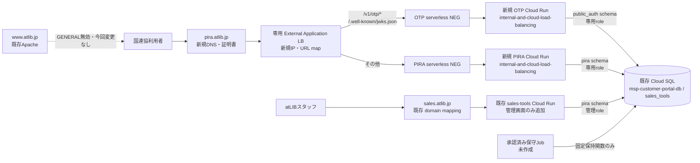

# SECU Insight GCP現物調査確定・本番配備設計 Phase 2E

照合日: 2026-11-04（Asia/Tokyo）

基準: PR #36 / `1c32fa8028400cf93bb90bca44dc695320cd93ab`

対象: GCP project `msp-zabbix` / region `asia-northeast1`

本書はRead-only現物調査と配備設計である。Production、Cloud Run、Cloud SQL、IAM、Secret、DNS、Migration、Trafficには変更を加えていない。

## 1. 結論

第一候補は次の構成とする。

- OTPとPIRA公開画面・受付は、新規の専用Cloud Run 2サービスへ分離する。
- `pira.atlib.jp`専用の外部Application Load Balancerを新設し、2つのserverless NEGへパス分岐する。
- 既存の共用LB、`www.atlib.jp`のApache、PPAP、既存コーポレートサイト経路は変更しない。
- 管理画面だけを既存Cloud Run `sales-tools`へ追加する。
- DBは既存Cloud SQL `msp-customer-portal-db`内の`sales_tools` databaseを第一候補とし、`public_auth` / `pira` schemaと専用DB roleで論理分離する。
- GENERALは無効のままとし、`www.atlib.jp`を変更しない。

ローカル実装は成立しているが、DB接続容量、migration ledger、専用DB user、外部サービス実設定、staging、本番rollback rehearsalが未確認であるため、Production判定は **NO-GO** を維持する。

## 2. GCP構成図

## 3. 確認済みFACT

### 3.1 Cloud Run

| Service | Revision / Traffic | SA | DB接続 | Ingress / IAM | Resource |
| --- | --- | --- | --- | --- | --- |
| `sales-tools` | `sales-tools-wsc-release`へ100% | `sales-tools-sa@...` | `msp-customer-portal-db` | ingress `all` / `allUsers` invoker | 1 CPU、1 GiB、concurrency 80、max 20 |
| `sales-tools-staging` | `sales-tools-staging-p228`へ100% | `sales-tools-staging-sa@...` | `sales-tools-staging-db` | ingress `all` / `allUsers`等 | 1 CPU、512 MiB、concurrency 80、min 0、max 2 |
| `msp-customer-portal` | `msp-customer-portal-00068-6v2`へ100%。最新Readyは別tag `00072-rup` | `msp-customer-portal-sa@...` | `msp-customer-portal-db` | ingress `all` / `allUsers` invoker | 1 CPU、512 MiB、concurrency 80、max 5 |

- `sales.atlib.jp`はCloud Run domain mappingで`sales-tools`へ接続する。
- Artifact Registryは`asia-northeast1`の`cloud-run-source-deploy`を使用している。
- OTP/PIRA専用Cloud Run serviceおよび専用service accountは存在しない。
- `sales-tools`は既に本番Secret参照、Workspaceスタッフ認証、Cloud SQL接続を持つため、管理画面追加先としてFitする。

### 3.2 Cloud SQL

| Instance | Version / tier | DB | Users | Availability / recovery |
| --- | --- | --- | --- | --- |
| `msp-customer-portal-db` | PostgreSQL 16 / `db-f1-micro` / 10 GiB SSD | `msp_customer_portal`, `ppap_transfer`, `ppap_sso_verify`, `sales_tools` | `portal_app`, `ppap_app`, `ppap_sso_verify_app`, `sales_tools_app`, `sales_tools_migration`, `postgres` | ZONAL、backup有効、30世代、PITR有効、transaction log 7日 |
| `sales-tools-staging-db` | PostgreSQL 16 / `db-f1-micro` / 10 GiB SSD | `sales_tools_staging`等 | `sales_tools_runtime`, `sales_tools_migration`, `postgres` | ZONAL、backup有効、30世代、PITR有効、transaction log 7日 |

- 両instanceともPublic IPv4は有効。Cloud RunはCloud SQL attachmentとUnix socketを使用する。
- `sslMode`は現物上`ALLOW_UNENCRYPTED_AND_ENCRYPTED`だが、Cloud RunからはCloud SQL connector経路を使用する。
- 自動storage resizeは有効。instance deletion protectionは確認結果に現れず、明示的な有効証跡はない。
- 直近5件の自動backupは両instanceともSUCCESSFULだった。
- 本番migration ledger、schema、table/role privilegeはDB認証情報を取得せずに調査したため未確認。

### 3.3 公開経路

- `pira.atlib.jp`: DNS解決不可。未登録。
- `www.atlib.jp`: `atlib.jp`へCNAME、`34.146.160.232`、Apache応答。`msp-zabbix`内の現行LB/VMとは一致せず、別管理経路。
- `sales.atlib.jp`: `ghs.googlehosted.com`へCNAME、Cloud Run domain mappingで`sales-tools`へ接続。
- 現行GCP HTTPS LBはZabbix、Cashflow、PPAP向け。`pira`、`www`、`sales`のhost ruleはない。
- 現行LBのserverless NEGはCashflowとPPAP向け。PIRA用NEGは存在しない。
- 現行GCP管理証明書はZabbix、Cashflow、PPAP向けで、`pira.atlib.jp`証明書は存在しない。
- Cloud DNS managed zoneはproject内に存在しない。`atlib.jp`の権威DNS管理場所は未確認。

### 3.4 IAM・Secret・監視

- `sales-tools`、staging、portalの各SAには`roles/cloudsql.client`が付与されている。
- Secret ManagerにはSales Tools DB/OAuth/JWT、staging DB/SMTP、portal SMTP等がある。
- OTP HMAC、OTP RS256鍵セット、Turnstile、OTP/PIRA専用DB passwordのSecretは存在しない。
- `portal-smtp-password`は既存`sales-tools-sa`から参照可能。技術流用は可能だが、OTP専用SAへ追加権限を与えるか専用Secretへ分離するかは未決定。
- LoggingはDefault 90日、Required 400日（locked）。SECU Insight固有sink/metric/alertは存在しない。
- alert policyはstaging uptimeとportal/topology向け。`sales-tools`本番およびSECU Insight専用uptime/alertは未整備。

## 4. PR #36 Fit/Gap

| 項目 | FACT | Gap | 対応案 | 未確定 |
| --- | --- | --- | --- | --- |
| OTP runtime | 専用entry point/Docker targetあり | GCP service/SA/Secretsなし | 新規専用Cloud Run + SA | service名、min/max、SMTP資格情報 |
| PIRA runtime | 専用entry point/Docker targetあり | GCP service/SA/NEGなし | 新規専用Cloud Run + SA | service名、min/max |
| Sales Tools管理 | 既存`sales-tools`・スタッフ認証・SAあり | PR #36未配備 | no-traffic Revisionで追加し既存認証を維持 | canary割合と承認者 |
| Cloud SQL | `sales_tools` DBが本番候補 | 専用role/userとledger未確認 | 同DBの2 schema + role分離 | max_connections、負荷余力 |
| DB role | Migration 041が5主体を想定 | 現物はapp/migrationのみ | admin=`sales_tools_app`候補、OTP/PIRA/maintenanceを追加 | role/user名とpassword運用 |
| Secret | 既存SMTP/DB secretあり | OTP/PIRA固有Secretなし | resource単位のAccessor | SMTP共有か分離か |
| JWT/JWKS | RS256/kid/rotation実装済み | 本番key/issuerなし | `https://pira.atlib.jp`をissuer候補、JWKSをLB経由 | 正式issuer、併存期間、cache |
| Turnstile | server verify実装済み | site/secretなし | `pira.atlib.jp`専用key | hostname設定、障害運用 |
| LB/DNS | 既存共用LBあり、pira未登録 | same-origin分岐なし | 専用LB + 2 NEG +新規DNS | DNS管理者、IP/証明書方式 |
| Backup/PITR | 有効、直近backup成功 | restore実証と直前backup未確認 | staging restore rehearsal後に直前backup | RPO/RTO、復旧承認者 |
| 監視 | Logging基盤あり | SECU Insight alertなし | service metrics、5xx、latency、DB、uptime alert | 通知先、閾値、保持 |
| 保持Job | CLI/DB関数あり | Job/SA/Scheduleなし | 専用Cloud Run Job + maintenance role | schedule、retry、承認フロー |

## 5. 本番構成

### 5.1 外部Application Load Balancer

既存共用LBを変更せず、専用のglobal external Application Load Balancerを第一候補とする。専用IP、target HTTPS proxy、URL map、2 backend services、2 serverless NEGs、Google-managed certificateを用意する。

URL map:

| Path | Backend |
| --- | --- |
| `/v1/otp/*` | OTP NEG |
| `/.well-known/jwks.json` | OTP NEG |
| その他（`/`, assets, `/api/public/pira/v1/*`） | PIRA NEG |

serverless NEGとCloud Runは同じproject・regionに配置する。Cloud Run ingressは`internal-and-cloud-load-balancing`とし、直接の`run.app`インターネット経路を閉じる。公開サービスのためCloud Run IAMはLB到達に必要なunauthenticated invocationを許可するが、IngressでLB経由に限定する。URL map適用前に専用IPでHost headerを使った検証を行う。

`trust proxy=1`はLBからCloud Runまでの1プロキシホップを前提とする実装である。本番前に`X-Forwarded-For`の実測とIP rate-limitテストで確定する。

### 5.2 Origin・認証

- 正式Origin候補: `https://pira.atlib.jp`
- issuer候補: `https://pira.atlib.jp`
- audience: 既存service id `pira-union`
- JWKS候補: `https://pira.atlib.jp/.well-known/jwks.json`
- OTP API: same-origin `/v1/otp/*`
- GENERAL: `PIRA_GENERAL_ENABLED=false`

候補値は統括承認とstaging E2Eで確定する。CORSは固定Originのみ、CSPは既存selfとTurnstile通信先のみを維持する。JWT秘密鍵はOTP SAだけが参照し、PIRAはJWKS公開鍵だけを取得する。新旧`kid`の併存期間をtoken TTLとcache TTL以上確保してから旧鍵を無効化する。

## 6. Cloud SQL利用方針比較

| 方式 | 費用 | 運用 | 障害影響 | 評価 |
| --- | --- | --- | --- | --- |
| 既存`msp-customer-portal-db` / `sales_tools`へschema追加 | instance固定費の追加なし。storage/backup/接続負荷のみ増加 | 既存backup/PITR、migration運用を再利用 | DB障害時にSales Toolsと同時影響。小型ZONAL instanceの容量を共有 | **第一候補**。role分離と容量確認が必須 |
| 既存instance内に専用database追加 | instance固定費の追加なし | databaseは分離するが、実装のDB名・migration・管理接続を増やす | instance障害は共有 | 現実装との差分が増えるため第二候補以下 |
| 新規Cloud SQL instance | compute、storage、backupの固定費増 | backup、監視、Secret、migrationを独立管理 | 障害範囲を最小化 | 高分離だが現段階の規模には運用過多。負荷試験で既存instance不適合の場合に再検討 |

第一候補ではMigration 037〜041を`sales_tools`へ適用する。037/038が`public_auth` / `pira` schemaを作り、041が権限を限定する。既存`sales_tools_migration`をMigration主体候補、既存`sales_tools_app`を管理runtime候補とする。OTP、PIRA、maintenanceは相互に異なる新規DB user/roleが必要である。Migration 041はroleを作成しないため、作成・password secret・Cloud Run SA対応を別承認手順で準備する。

本番前に次を取得する。

- `schema_migrations`の037〜041未適用と番号競合なし
- `max_connections`、現在接続数、既存maxScale 20とのcapacity budget
- migration/function ownerとrole privilege
- backup ID、PITR window、別DB restore rehearsal

## 7. 必要リソース

新規:

- Cloud Run service 2、専用service account 2
- serverless NEG 2、backend service 2
- global external Application Load Balancer一式、専用IPv4 1
- Google-managed certificate 1、`pira.atlib.jp` DNS record
- DB user/role 3（OTP、PIRA、maintenance）と各password Secret
- OTP HMAC、JWT key set、Turnstile secret、必要ならSMTP専用password Secret
- 保持用Cloud Run Jobと専用SA
- uptime/service metric/alert policy、必要なlog-based metric

既存再利用:

- `msp-customer-portal-db` / `sales_tools`
- `sales-tools` Cloud Run、`sales-tools-sa`、Workspace認証
- Artifact Registry `cloud-run-source-deploy`
- Cloud SQL backup/PITR、Cloud Logging/Monitoring
- Mailer実装。SMTP資格情報の共有可否は承認待ち

## 8. 月額費用概算

以下はUSD・税別の概算で、730時間/月、低トラフィックを前提とする。Billing accountのFree Tier消費状況、実リクエスト数、データ量は未確認である。

| 項目 | min instances 0 | min instances 1 |
| --- | ---: | ---: |
| Cloud Run 2サービス | request/CPU/RAM従量。低利用ならFree Tier内の可能性 | 1 CPU・512 MiBを各1台保温する単純計算で約`$19.71/月`＋active使用料（Free Tier/CUD前） |
| 専用LB forwarding rule | 約`$18.25/月` | 同左 |
| LB data processing | inbound/outbound各`$0.008/GiB` | 同左 |
| Certificate Manager | project内100証明書まで`$0` | 同左 |
| DNS | 外部既存zoneへrecord追加なら増分不明。Cloud DNS新規zoneなら約`$0.20/月`＋`$0.40/100万query` | 同左 |
| Secret Manager | free枠超過後、active version約`$0.06/月/個`、access `$0.03/1万回` | 同左 |
| 既存Cloud SQL再利用 | instance固定費増分`$0`。storage/backup/負荷増分のみ | 同左 |
| 新規db-f1-micro比較 | Tokyoの目安約`$10/月`前後＋storage/backup。shared-coreはSLA対象外 | 同左 |

基準案はCloud Run min 0で開始する。OTP/PIRAは同期HTTP処理であり常駐workerを必要としない。cold startが受入基準を満たさない場合だけ、実測後にmin 1を承認する。LBの約`$18.25/月`が低利用時の主な固定増分となる。新規Cloud SQLを選ぶ場合は分離効果と引き換えにinstance・storage・backup・運用の固定費が増える。

料金根拠:

- Cloud Run pricing: https://cloud.google.com/run/pricing
- Load Balancing pricing: https://cloud.google.com/vpc/network-pricing
- Cloud DNS pricing: https://cloud.google.com/dns/pricing
- Secret Manager pricing: https://cloud.google.com/secret-manager/pricing
- Certificate Manager pricing: https://cloud.google.com/certificate-manager/pricing
- Cloud SQL pricing: https://cloud.google.com/sql/pricing

## 9. 配備・停止・切り戻し手順

| 工程 | 実行条件・確認 | STOP条件 | 切り戻し |
| --- | --- | --- | --- |
| 1. 事前確認 | 承認者、immutable SHA/image digest、GCP現物snapshot、GENERAL=false | main/PR/現物不一致 | 変更前なので不要 |
| 2. Backup | backup/PITR有効、直前backup成功、restore rehearsal | backup失敗、復元未実証 | 配備中止 |
| 3. DB role | 専用user/role/Secret、SA対応、capacity budget | role分離不能、接続余力不足 | 作成した未使用資格情報を無効化（別承認） |
| 4. Migration | 専用migration主体で037→041、ledger/owner/権限検証 | 番号競合、途中失敗、権限過大 | runtime配備中止。手動down禁止、DB復元は責任者判断 |
| 5. Secret/IAM | resource単位Accessor、JWT/Turnstile/SMTP、値非表示 | SA間の不要共有、必須値不足 | 新version無効化、IAMを承認済み前状態へ |
| 6. OTP Cloud Run | 新規service、ingress制限、min 0、health/JWKS/SMTP/Turnstile | 起動失敗、secret漏えい、DB権限過大 | serviceを公開経路へ接続しない |
| 7. PIRA Cloud Run | 新規service、ingress制限、GENERAL=false、JWT/DB検証 | 別aud受付、GENERAL到達、回答永続化 | serviceを公開経路へ接続しない |
| 8. Sales Tools | no-traffic Revision、staff auth、管理者/閲覧者、CSV/XLSX/監査 | 既存機能回帰、監査失敗 | 現在の`sales-tools-wsc-release`へ100%復帰 |
| 9. LB/cert | 専用IP/NEG/backend/URL map、証明書ACTIVE | 既存LB変更、証明書未発行 | 専用LBのみ削除候補。既存経路不変 |
| 10. DNS | 低TTLで`pira`を専用IPへ、事前Host検証済み | DNS管理者不明、誤IP | `pira` recordを直前値へ。現状未登録なら削除 |
| 11. Smoke | OTP→受付→8問→report→COMPLETED、管理反映、印刷、資料 | 5xx、固定文/デザイン不一致、DB/監査異常 | DNS/LB経路を戻し、新規受付停止 |
| 12. 監視 | 5xx、latency、instance、DB接続、SMTP/Turnstile、retention | alert未配線、ログに秘密値 | trafficを戻し原因調査 |

DB Migrationはadditiveであり、Cloud Run Revision rollbackとDB rollbackは別判断とする。runtime不具合では旧Revisionへ戻し、schemaは保持する。データ整合性問題だけは書込み停止後にbackup/PITRをDB責任者が判断する。OTP障害時に認証を迂回して受付を許可しない。

## 10. Go/No-Go判定材料

Goに必要:

1. GENERAL無効とUNION公開範囲の統括承認
2. DNS管理主体、専用LB/IP、証明書方式の承認
3. 専用Cloud Run service/SA名、Ingress/IAM、min/max/concurrencyの承認
4. DB capacity、ledger、role/user/owner、backup/PITR/restoreの証跡
5. Secret名・Accessor・rotation、JWT issuer/kid/併存期間の承認
6. 本番SMTP/Turnstileのstaging検証
7. `trust proxy`、CORS/CSP、rate limitのLB経由実測
8. 管理画面を含む既存Sales Tools回帰とcanary手順
9. SECU Insight監視・通知先・閾値、保持Jobの承認
10. DNS、Revision、DBの各切り戻しrehearsalと担当者

いずれかが欠ける場合はNo-Goを維持する。

## 11. 未確認事項

- `atlib.jp`権威DNSの管理サービス・権限者
- 本番`sales_tools.schema_migrations`と037〜041の競合有無
- Cloud SQL `max_connections`、現在接続数、負荷・storage増分
- DB/function ownerと既存privilege
- `msp-customer-portal-db`のdeletion protection明示設定
- 実SMTP送信上限・専用資格情報の要否
- Turnstile本番site/secretと許可hostname
- JWT本番key生成・保管・rotation承認者
- Monitoring通知先、SLO、alert threshold
- 保持Jobのschedule、timeout、retry、承認フロー
- 本番Traffic canary割合と各工程の実行者・承認者

## 12. 公式資料との整合

- serverless NEGはCloud Runと同じproject/regionに置き、URL mapで複数backendへ振り分け可能。
- Cloud Run `internal-and-cloud-load-balancing`は外部Application Load Balancer経由を許可し、直接の外部`run.app`到達を制限する。
- serverless NEGには通常health checkを付けられないため、Cloud Run service metrics、uptime/synthetic monitoring、事前Revision試験を組み合わせる。
- LB/Cloud Run/Secret/DNS/Cloud SQLはそれぞれ別課金であり、Free Tierはbilling account全体の使用状況に依存する。

参照:

- https://cloud.google.com/load-balancing/docs/negs/serverless-neg-concepts
- https://cloud.google.com/run/docs/securing/ingress
- https://cloud.google.com/load-balancing/pricing
- https://cloud.google.com/run/pricing
